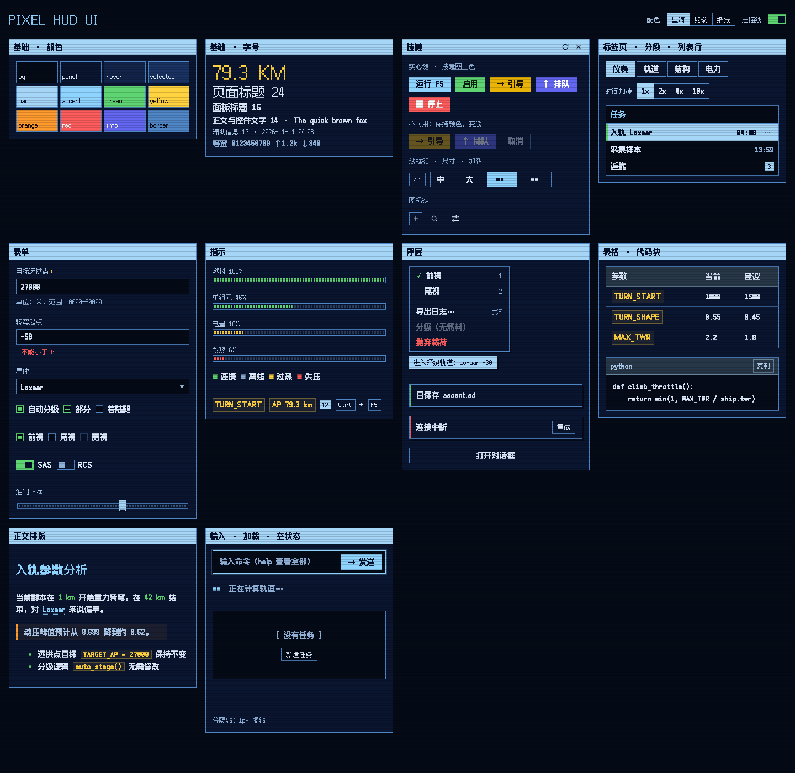
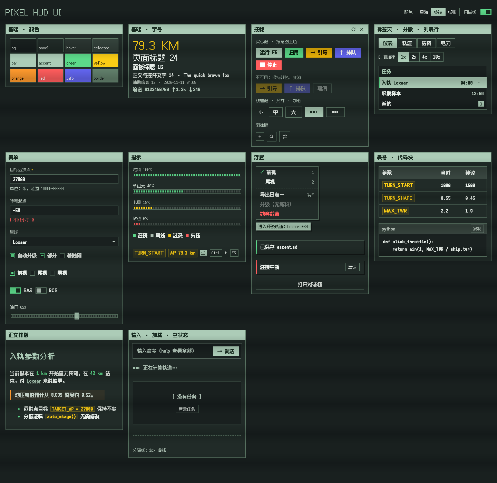
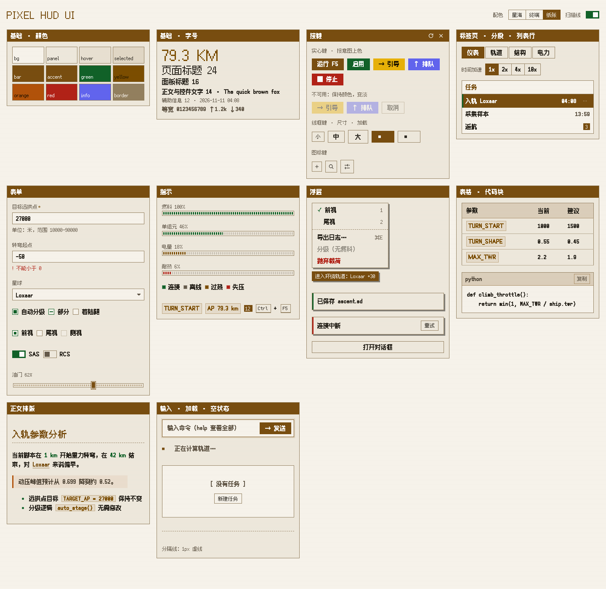
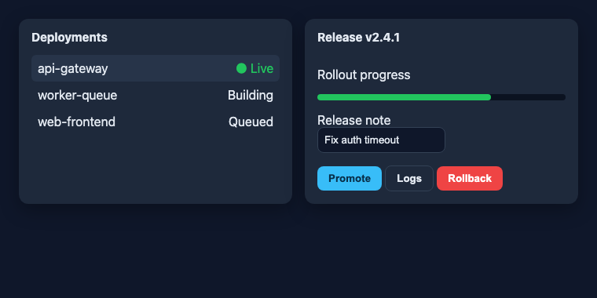
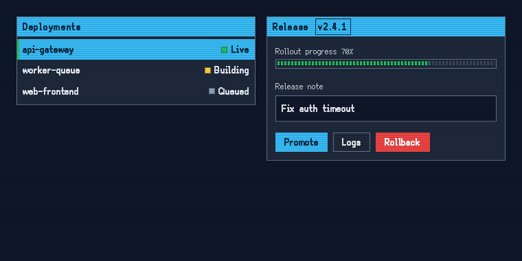

# Pixel HUD UI

一套「飞行计算机 / 复古游戏 HUD」风格的 UI 框架，同时也是一个 [Claude 技能（Skill）](https://docs.claude.com/en/docs/agents-and-tools/agent-skills/overview)。

- **设计规范**：网格、字号、颜色职责、动效，以及二十多种控件的结构、尺寸、状态、用法和无障碍要求（[`references/design-system.md`](references/design-system.md)）。
- **CSS 套件**：一个文件，加一个属性就能用；控件用 `hud-*` 类名按需启用，不碰你项目已有的样式。
- **配色**：内置星海、终端、纸张三套；也可以把你项目自己的品牌色映射进来。
- **Claude 技能**：装上以后，对 Claude 说「用像素 HUD 风格做这个界面」或「把这个页面改成像素 HUD 风格」，它会按规范完成。



<table><tr>
<td></td>
<td></td>
</tr></table>

**改造已有页面**（保留原来的品牌色）：

<table><tr>
<td></td>
<td></td>
</tr></table>

## 作为 Claude 技能安装

**Claude Code**：把这个仓库放进技能目录。

```bash
git clone https://github.com/dodio12138/pixel-hud-ui.git ~/.claude/skills/pixel-hud-ui
```

只在某个项目里用，就放到项目的 `.claude/skills/pixel-hud-ui`。

**Claude.ai / Claude 桌面版**：在「设置 › 能力 › 技能」里上传这个文件夹的 zip 包。

装好后直接描述需求即可，例如：

- 「用像素 HUD 风格给我做一个部署控制台页面」
- 「把这个 Next.js 项目的设置页改成像素 HUD 风格，保留我们的品牌色」
- 「做一套像素风的游戏 HUD 界面：燃料条、状态灯、任务列表」

## 不用 Claude，直接用 CSS

```html
<html data-skin="pixel" data-hud-palette="starward">
<head>
  <link rel="stylesheet" href="assets/fonts.css">
  <link rel="stylesheet" href="assets/palettes.css">
  <link rel="stylesheet" href="assets/pixel-hud.css">
</head>
<body>
  <section class="hud-panel">
    <div class="hud-titlebar"><h2>仪表</h2></div>
    <div class="hud-panel__body">
      <div class="hud-gauge" style="--value: .72"></div>
      <span class="hud-lamp" data-state="on">连接</span>
      <button class="hud-btn is-solid" data-intent="go">启用</button>
    </div>
  </section>
  <script src="assets/pixel-caret.js"></script>
</body>
</html>
```

打开 [`assets/demo.html`](assets/demo.html) 可以看到所有控件和状态。各技术栈（Tailwind、shadcn/ui、React/Next.js、Vue）的接入方法见 [`references/integration.md`](references/integration.md)。

## 目录

```
SKILL.md                      技能说明：工作流程与关键规则
references/design-system.md   设计规范（基础 + 每个控件）
references/integration.md     各技术栈接入方法、颜色映射、变量清单
assets/pixel-hud.css          框架本体
assets/palettes.css           内置配色
assets/fonts.css              像素字体（jsDelivr，固定版本）
assets/pixel-caret.js         块状输入光标（可选）
assets/demo.html              控件演示页
scripts/check-contrast.mjs    配色对比度检查（WCAG）
```

## 自定义配色

```css
[data-hud-palette="mine"] {
  --hud-bg: #101418;  --hud-panel: #182028;  --hud-text: #e8eef4;
  --hud-accent: #ffb347;  --hud-accent-contrast: #1a1000;
  /* …其余变量见 references/integration.md › Token contract */
}
```

```bash
node scripts/check-contrast.mjs my-palette.css
```

## 浏览器支持

Chrome / Edge 111+、Safari 16.2+、Firefox 113+（依赖 `color-mix()` 和 `:is()`）。

## 授权

代码与文档：[MIT](LICENSE)。
像素字体 [Fusion Pixel](https://github.com/TakWolf/fusion-pixel-font)（TakWolf）：SIL Open Font License 1.1，通过 [Fontsource](https://fontsource.org) 加载，不包含在本仓库中。

---

## English

**Pixel HUD UI** is a retro flight-computer / game-HUD UI framework packaged as a Claude Skill: a design spec for foundations and over 20 controls (anatomy, sizes, states, usage, accessibility), a drop-in CSS kit turned on by `data-skin="pixel"` with opt-in `hud-*` classes, three palettes (or your brand colors mapped onto `--hud-*` tokens), a block-caret script and a WCAG contrast checker. Install it into `~/.claude/skills/pixel-hud-ui` and ask Claude to "build this in the Pixel HUD style", or use the CSS directly. See `SKILL.md`, `references/design-system.md` (Chinese) and `references/integration.md`.
